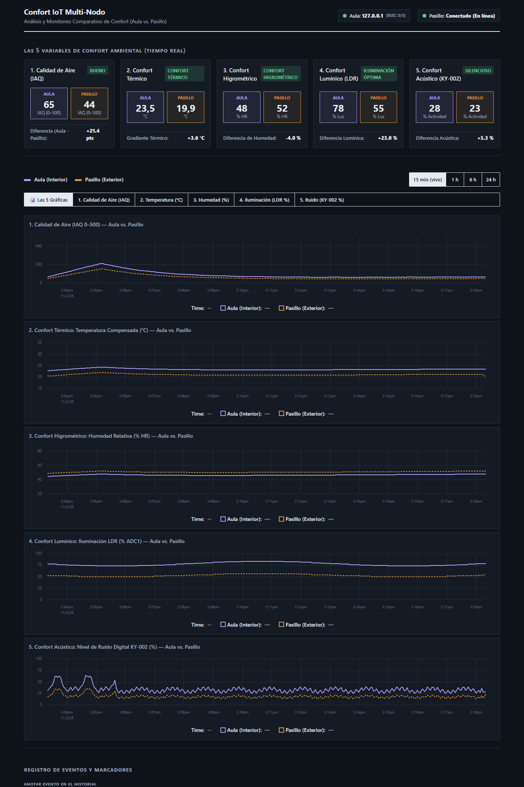
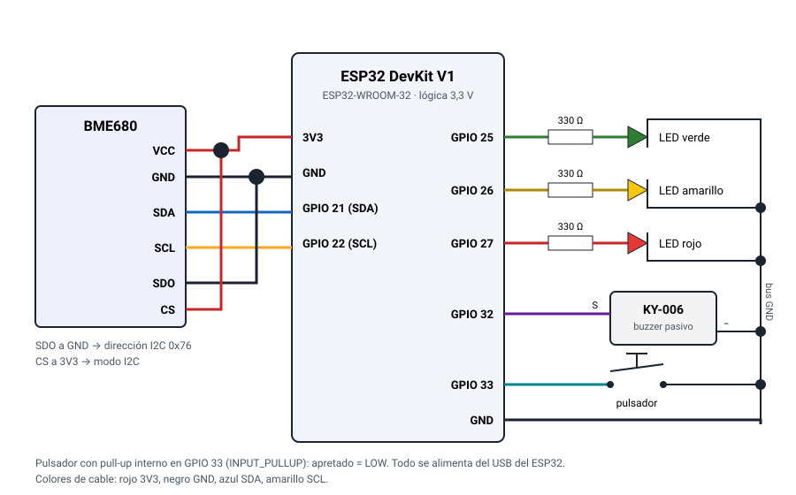

# UTN FRCU – Tecnologías para la Automatización ESP32 2026
## Aire IoT — Monitor de calidad de aire interior (ESP32 + BME680)

### Equipo (Etapa 1)
* **Número de equipo:** 9
* **Integrantes:**
  * Slootmans, Maria
  * Nuñez Baccón, Victoria
  * Valli, Franco Ignacio

### Descripción del proyecto

Un ESP32 lee un sensor Bosch **BME680**, procesa la señal mediante la librería oficial de Bosch **BSEC2** y calcula un **índice de calidad de aire interior (IAQ 0–500)**, CO₂ equivalente, VOC equivalente, temperatura, humedad y presión. 

Con estos datos:
* Enciende un **LED verde, amarillo o rojo** según el nivel, con **histéresis** para evitar oscilaciones en los umbrales de cambio.
* Activa un **buzzer** cuando la calidad del aire es mala, mientras que un **pulsador** permite silenciarlo o registrar marcas de eventos.
* Sirve un **panel web (dashboard)** desde su propia memoria flash que funciona **sin necesidad de internet**, accesible desde un teléfono móvil o PC.
* Almacena **24 horas de historial** y permite exportarlo como **CSV** (conjunto de datos para una etapa posterior de Machine Learning).

En un aula, oficina o cocina el ambiente se vicia sin que lo notemos: CO₂ por la respiración, vapores de productos de limpieza, humo de cocción. Esto disminuye la concentración y puede afectar la salud. El dispositivo indica **cuándo ventilar** y permite observar cómo se recupera el ambiente tras hacerlo, con un costo accesible en componentes.



#### Tecnologías utilizadas
ESP32 (core Arduino de Espressif 3.3.12), Arduino IDE 2.x, C++, Bosch BSEC2, ESP Async WebServer + WebSocket, ArduinoJson, panel web en HTML/CSS/JS con uPlot, Python 3 (script de empaquetado y servidor mock).

### Componentes utilizados

| Componente | Cantidad | Notas |
| :--- | :---: | :--- |
| **ESP32 DevKit V1** | 1 | ESP32-WROOM-32 (30 o 38 pines). Dual core 240 MHz, 520 KB SRAM, 4 MB flash, Wi-Fi 2.4 GHz. Lógica de 3.3 V. Microcontrolador, servidor web y punto de acceso Wi-Fi. |
| **Breakout BME680** | 1 | Alimentación 1.7–3.6 V (usar 3V3), I2C en 0x76 o 0x77. Mide temperatura, humedad, presión y resistencia de gas. Muestreo cada 3 s (modo BSEC LP). |
| **LEDs (verde, amarillo, rojo)** | 3 | Indicador del nivel de calidad de aire. Caída de ~2 V, ~4 mA cada uno. |
| **Resistencias de 220–330 Ω** | 3 | En serie con cada LED. |
| **Buzzer pasivo KY-006** | 1 | Requiere señal alternada (PWM con periférico LEDC). |
| **Pulsador** | 1 | Normalmente abierto, a GND con pull-up interno. Antirrebote por software (30 ms). |
| **Protoboard y jumpers** | 1 / ~15 | Protoboard de 400 puntos. Cables de sensor cortos (< 20 cm). |
| **Fuente de alimentación** | 1 | Cable de datos USB (5 V desde computadora o cargador). |

#### Cableado

Los pines están definidos en un único lugar: `firmware/aire_iot/config.h`.

| Señal | Pin ESP32 | Función |
| :--- | :--- | :--- |
| BME680 VCC / GND | 3V3 / GND | Alimentación (nunca 5 V) |
| BME680 SDA / SCL | GPIO 21 / GPIO 22 | Bus I2C por defecto |
| BME680 SDO | GND | Fija dirección I2C en 0x76 |
| BME680 CS | 3V3 | Mantiene el sensor en modo I2C |
| LED verde / amarillo / rojo | GPIO 25 / 26 / 27 | Salidas digitales (con 330 Ω en serie) |
| KY-006 S / − | GPIO 32 / GND | Salida PWM LEDC para tono sonoro |
| Pulsador | GPIO 33 ↔ GND | Entrada digital con pull-up |

Todos estos pines están presentes tanto en placas de 30 como de 38 pines. Se evitan intencionalmente los GPIO 6–11 (flash interna) y pines de arranque (0, 2, 5, 12, 15).



Para el cableado completo y distribución paso a paso en protoboard, consultar [docs/conexion.md](docs/conexion.md).

### Instrucciones de uso

#### Versiones probadas

| Elemento | Versión |
| :--- | :--- |
| Arduino IDE | 2.x |
| Core esp32 de Espressif | 3.3.12 |
| bsec2 (Bosch Sensortec) | 1.10.2610 |
| BME68x Sensor library (Bosch Sensortec) | 1.3.40408 |
| ESP Async WebServer (por ESP32Async) | 3.12.1 |
| Async TCP (por ESP32Async) | 3.5.0 |
| ArduinoJson (Benoit Blanchon) | 7.4.3 |
| uPlot (incluido en web/) | 1.6.32 |

Medido al compilar: 1.161.816 B de flash (88 %) y 100.624 B de RAM global (30 %). Toda la página web pesa 35.2 KB comprimida.

> **Importante:** Existen varias librerías llamadas "AsyncWebServer" y "AsyncTCP". Asegurarse de instalar las desarrolladas por **ESP32Async** (mantenidas y compatibles con el core 3.x).

#### Puesta en marcha paso a paso

1. **Instalar el entorno:**
   * En *Archivo → Preferencias → URLs adicionales del gestor de placas* agregar:
     `https://espressif.github.io/arduino-esp32/package_esp32_index.json`
   * En *Herramientas → Placa → Gestor de placas* buscar **esp32** e instalar la versión **3.3.12**.
   * En *Herramientas → Administrar librerías* instalar las versiones exactas indicadas en la tabla (`bsec2`, `ESP Async WebServer`, `Async TCP` y `ArduinoJson`).

2. **Cablear el circuito:**
   * Seguir la tabla de conexiones.
   * Antes de cargar el firmware completo, subir `tools/i2c_scanner/i2c_scanner.ino` para verificar que el sensor responde en **0x76**.

3. **Subir el firmware:**
   * Abrir `firmware/aire_iot/aire_iot.ino`.
   * Copiar `firmware/aire_iot/secrets.example.h` como `firmware/aire_iot/secrets.h` y completar las credenciales Wi-Fi.
   * Seleccionar la placa *ESP32 Dev Module* y el puerto COM correspondiente.
   * Si la subida falla con error de conexión, reducir la velocidad de subida a **115200** baudios o mantener pulsado el botón **BOOT**.

4. **Acceso al sistema:**
   * **Con Wi-Fi:** acceder a `http://aire.local` o a la IP indicada en el monitor serial (115200 baudios).
   * **Modo Punto de Acceso (AP):** si no hay Wi-Fi disponible tras 15 segundos, conectarse a la red **AireIoT** (clave: `aire1234`) y navegar a `http://192.168.4.1`.

#### Modos de operación y controles

| Acción | Comportamiento |
| :--- | :--- |
| **IAQ > 100 / 200** | Transición a LED amarillo / rojo. En rojo emite 3 pitidos cada 30 s. |
| **Pulsación corta (< 1 s)** | Silencia la alarma sonora durante 15 minutos. |
| **Pulsación larga (≥ 1.5 s)** | Registra un marcador de evento en el historial (ej. "ventana abierta"). |
| **Exportar CSV** | Descarga el dataset de las últimas 24 horas con marcas temporales. |
| **Editor web de umbrales** | Permite ajustar niveles de IAQ, histéresis y tiempos de repetición. |

**Calibración:** BSEC requiere tiempo de funcionamiento para calibrarse. El panel web indica la precisión de 0 a 3. Con precisión 0–1 el IAQ no es confiable y el buzzer permanece apagado. La calibración se almacena en memoria no volátil para preservarse tras reinicios.

### Simulación y pruebas sin hardware

* **Modo simulación en firmware:** Descomentar `#define SIMULATION` en `firmware/aire_iot/config.h`. El firmware genera un ciclo sintético de 20 minutos con eventos de ventilación sin requerir el sensor físico.
* **Servidor mock en PC (Python):**
  ```bash
  python3 -m pip install -r tools/requirements.txt
  python3 tools/mock_server.py --rapido
  ```
* **Pruebas unitarias nativas en C++:**
  ```bash
  g++ -std=c++17 -Wall -Wextra -I firmware/aire_iot tools/test_nativo.cpp \
      firmware/aire_iot/control.cpp firmware/aire_iot/muestras.cpp -o build/test_nativo
  ./build/test_nativo
  ```

### Documentación técnica de referencia

* [docs/informe_etapa1.md](docs/informe_etapa1.md): Informe formal de la Etapa 1.
* [docs/codigo.md](docs/codigo.md): Guía y arquitectura del código fuente.
* [docs/conexion.md](docs/conexion.md): Detalle exhaustivo de conexionado.
* [docs/conceptos_teoricos.md](docs/conceptos_teoricos.md): Modelado de histéresis y lazo de control.
* [docs/complicaciones.md](docs/complicaciones.md): Registro de problemas resueltos durante el desarrollo.
