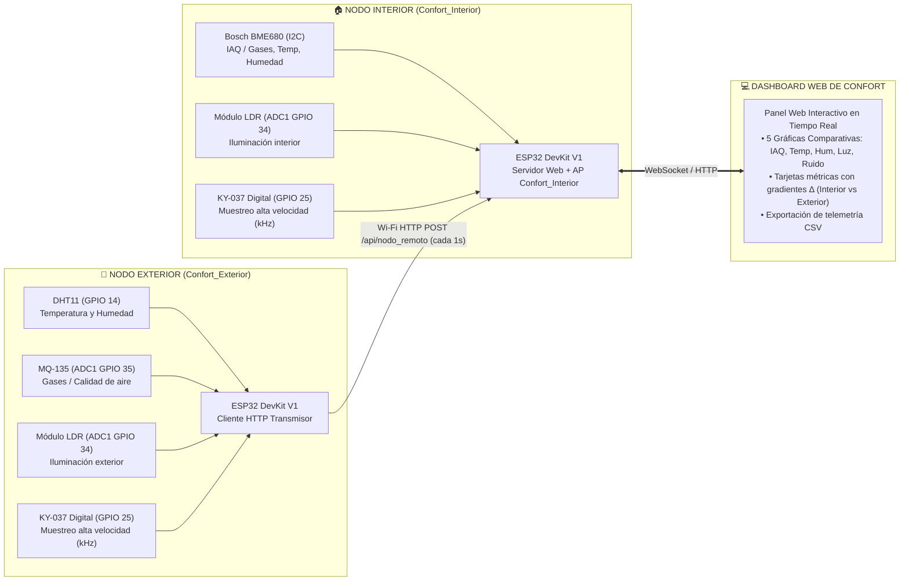
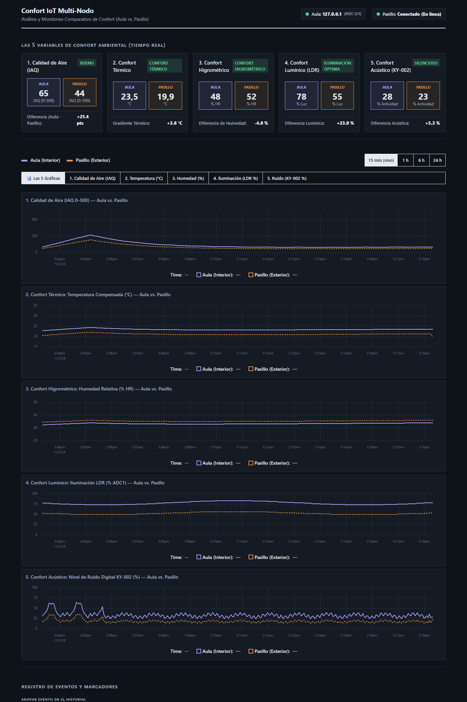

# UTN FRCU – Tecnologías para la Automatización ESP32 2026
## Confort Multi-Nodo (Etapa 2) — Monitoreo Comparativo Ambiental Multi-Escenario

### Identificación del Proyecto (Etapa 2)
* **Número de equipo:** 9
* **Integrantes:**
  * Slootmans, Maria
  * Nuñez Baccón, Victoria
  * Valli, Franco Ignacio
* **Proyecto recibido de Etapa 1:** Aire IoT (Monitor mononodo interior con BME680, LEDs y buzzer).
* **Nuevo nombre del sistema:** `confort`

---

### Descripción del Proyecto y Enfoque de Confort

En la **Etapa 2**, el proyecto evoluciona de un simple monitor de aire interior a una **plataforma modular y distribuida de monitoreo y análisis de confort ambiental multi-escenario**.

El sistema fue concebido para comparar dinámicamente dos entornos vinculados:
* **Ámbito Académico:** Aula de clases vs. Pasillo de la facultad.
* **Ámbito Residencial:** Interior del hogar (dormitorio/sala) vs. Balcón o pasillo común.
* **Ámbito Gastronómico / Comercial:** Salón de clientes (hamburguesería, bar) vs. Vereda / exterior.

La arquitectura se compone de **dos módulos ESP32 dedicados e independientes**:
1. **Nodo Interior (`Confort_Interior`):** Concentrador central, servidor web y punto de acceso Wi-Fi. Mide las 5 variables de confort del recinto interno mediante un sensor ambiental **BME680**, un módulo **LDR** y un micrófono **KY-037**.
2. **Nodo Exterior (`Confort_Exterior`):** Nodo periférico transmisor. Mide las 5 variables de referencia en el exterior/pasillo mediante un sensor **DHT11** (temperatura y humedad), un sensor de gases **MQ-135** (calidad de aire), un módulo **LDR** y un micrófono **KY-037**.

Ambos nodos transmiten sus lecturas para presentarlas en un **dashboard web comparativo en tiempo real** servido localmente por el ESP32 Interior.

> **Resiliencia y Modo Autónomo:** Si el Nodo Exterior se encuentra apagado o fuera de alcance, el Nodo Interior opera normalmente de forma autónoma. El dashboard visualiza al 100 % las variables internas y marca el exterior como "Sin señal (Solo Interior)", evitando bloqueos o cálculos erróneos contra cero.





---

### Componentes y Lógicas Descartadas del Proyecto Original

1. **LEDs discretos de colores (verde, amarillo, rojo):** Se descartan. La señalización física resulta redundante frente al panel web responsivo accesible desde cualquier dispositivo móvil o PC.
2. **Buzzer pasivo KY-006 (alarma sonora):** Se descarta. Las alertas acústicas resultan disruptivas e indeseables en entornos de estudio o trabajo; la supervisión es completamente visual.
3. **Registro de eventos y marcadores manuales:** Se eliminan de la interfaz y del firmware para centrar el sistema de forma limpia en la adquisición continua de telemetría ambiental sin fricción para el usuario.
4. **Matriz de Decisión de Ventilación:** Se descartó la prescripción rígida de apertura de ventanas; el sistema proporciona la analítica visual comparativa para que los usuarios tomen decisiones informadas según el contexto.
5. **Firmware unificado por roles (`NODO_ROL`):** Se eliminó el firmware monolítico con `#define ROL_AULA / ROL_PASILLO`. Cada placa cuenta ahora con su propio proyecto de firmware optimizado según los sensores físicos conectados (`firmware/Confort_Interior` y `firmware/Confort_Exterior`).

---

### Las 5 Variables de Confort Analizadas

| Magnitud | Sensor Nodo Interior | Sensor Nodo Exterior | Unidad / Rango | Relevancia de Confort |
| :--- | :--- | :--- | :---: | :--- |
| **Calidad de Aire / Gases** | Bosch BME680 (Gas MOX) | Hanwei MQ-135 (Gas SnO₂) | 0–500 IAQ / kΩ | Ventilación, presencia de COV y pureza respirable. |
| **Confort Térmico** | Bosch BME680 | Aosong DHT11 | °C | Sensación térmica, balance y gradiente $\Delta T$. |
| **Confort Higrométrico** | Bosch BME680 | Aosong DHT11 | % HR (0–100) | Humedad relativa óptima de permanencia (35–60 %). |
| **Confort Lumínico** | Módulo LDR (fotorresistencia) | Módulo LDR (fotorresistencia) | % Luz (0–100) | Nivel visual adecuado para trabajo/estudio vs. exterior. |
| **Confort Acústico** | Módulo KY-037 (salida DO) | Módulo KY-037 (salida DO) | % Ruido (0–100) | Detección de bullicio e impacto sonoro en tiempo real. |

#### Cómo se calcula el IAQ en cada nodo

Ninguno de los dos nodos usa un índice normalizado de terceros: cada uno deriva su propio IAQ desde la resistencia del sensor de gas.

| Nodo | Sensor | Cálculo (`sensor.cpp`) | Escala |
| :--- | :--- | :--- | :---: |
| Interior | BME680 (MOX) | `calcularIaq(gasOhm, humPct)`: base adaptativa por media exponencial (`gasBase`) + penalización por humedad | 10–500 |
| Exterior | MQ-135 (SnO₂) | `leerMq135()`: relación contra referencia fija, `25 + (ratio − 1) × 110` | 25–500 |

> **Nota metodológica:** ambos IAQ son heurísticas propias calculadas sobre sensores distintos, por lo que son válidos para seguir tendencias dentro de cada nodo, no para comparar valores absolutos entre interior y exterior. Las magnitudes directamente comparables son temperatura, humedad, luz y ruido.

> **Resolución de los sensores:** el **DHT11** entrega 1 °C y 1 % HR, mientras que el **BME680** del nodo interior resuelve 0.01 °C y 0.1 % HR. Las diferencias menores a una unidad están por debajo del poder de resolución del nodo exterior y no deben interpretarse como diferencias reales de temperatura o humedad.

---

### Desafío de Ingeniería: Muestreo del Sensor Digital de Sonido (KY-037)

El sensor KY-037 utilizado toma su lectura desde el pin **DO (salida digital del comparador LM393)**:
* Cuando las ondas sonoras superan el umbral ajustado con el potenciómetro multivuelta, el comparador bascula generando trenes de pulsos rápidos de microsegundos a milisegundos.
* Una lectura tradicional por sondeo (`digitalRead`) cada 1 o 3 segundos perdería más del 99 % de los eventos acústicos.
* **Solución implementada:** Se configura una interrupción por hardware (`attachInterrupt` con flanco `CHANGE`) alojada en la memoria RAM ultra-rápida (`IRAM_ATTR`). El microcontrolador cuenta cada transición en frecuencias de kHz y calcula la tasa de pulsos en ventanas de integración de 1 segundo:
  $$\text{Frecuencia (Hz)} = \frac{\text{pulsos} \times 1000}{\Delta t_{\text{ms}}}$$
  $$\text{Ruido (\%)} = \min\left(100, \frac{\text{Frecuencia}}{300} \times 100\right)$$

---

### Asignación de Pines y Cableado

> **Regla Crítica de Diseño en ESP32:** El conversor analógico-digital interno **ADC2** queda completamente deshabilitado e inutilizable cuando el módem Wi-Fi se encuentra activo. Por esta razón, **todos los sensores analógicos (LDR y MQ-135) se conectan estrictamente a pines de ADC1 (GPIO 32 a 39)**.

#### 1. Cableado Nodo Interior (`firmware/Confort_Interior`)

| Señal | Pin ESP32 | Tipo | Función / Conexión |
| :--- | :--- | :--- | :--- |
| **BME680 VCC / GND** | **3V3 / GND** | Alimentación | 3.3 V regulado (alimentar solo con 3.3 V) |
| **BME680 SDA / SCL** | **GPIO 21 / GPIO 22** | Digital I2C | Bus I2C principal (detección auto `0x76` o `0x77`) |
| **BME680 SDO** | **GND** | Configuración | Fija dirección I2C en `0x76` (o 3V3 para `0x77`) |
| **BME680 CS** | **3V3** | Configuración | Fija el sensor en modo I2C (no SPI) |
| **LDR (Salida analógica AO)** | **GPIO 34** | Entrada Analógica | Conectado a **ADC1_CH6** (lectura estable con Wi-Fi) |
| **KY-037 (Salida digital DO)** | **GPIO 25** | Entrada Digital | Pin con interrupción de hardware (`CHANGE`) |

#### 2. Cableado Nodo Exterior (`firmware/Confort_Exterior`)

| Señal | Pin ESP32 | Tipo | Función / Conexión |
| :--- | :--- | :--- | :--- |
| **DHT11 VCC / GND** | **3V3 / GND** | Alimentación | Alimentación del sensor térmico e higrométrico |
| **DHT11 DATA** | **GPIO 14** | Entrada Digital | Bus digital 1-wire con driver de precisión sin dependencias |
| **MQ-135 VCC / GND** | **5V (VIN) / GND** | Alimentación | 5 V requerido para el calefactor del sensor de gas |
| **MQ-135 (Salida AO)** | **GPIO 35** | Entrada Analógica | Conectado a **ADC1_CH7** (lectura estable con Wi-Fi) |
| **LDR (Salida analógica AO)** | **GPIO 34** | Entrada Analógica | Conectado a **ADC1_CH6** (lectura estable con Wi-Fi) |
| **KY-037 (Salida digital DO)** | **GPIO 25** | Entrada Digital | Pin con interrupción de hardware (`CHANGE`) |

---

### Comunicación e Infraestructura de Red

* **Estructura de Firmware:**
  * `firmware/Confort_Interior/`: Contiene el sketch principal, servidor web asíncrono (`ESPAsyncWebServer`), WebSocket, NVS, buffer circular de telemetría y generador de CSV.
  * `firmware/Confort_Exterior/`: Contiene el sketch emisor ligero, cliente HTTP (`HTTPClient`) y drivers directos de muestreo sin librerías externas para DHT11 y MQ-135.
* **Punto de Acceso Autónomo (Modo AP):**
  * El Nodo Interior levanta el punto de acceso Wi-Fi:
    * **SSID:** `Confort_Interior`
    * **Contraseña:** `confort1234`
    * **IP Servidor:** `192.168.4.1`
* **Conexión Automática del Nodo Exterior:**
  * El Nodo Exterior se asocia inmediatamente a dicho AP (o a una red Wi-Fi compartida configurada en `secrets.h`) y despacha un payload JSON cada 1 segundo:
    ```json
    {
      "iaq": 42.5,
      "temp": 21.5,
      "hum": 52.0,
      "gas": 45.2,
      "ldr": 58.0,
      "sonido": 12.0,
      "pulsos": 37,
      "acc": 2,
      "conectado": true
    }
    ```
  * Endpoint receptor: `POST http://192.168.4.1/api/nodo_remoto`, que responde `{"ok":true}`.
  * **Timeout de enlace:** si el Interior pasa **15 s** (`REMOTO_TIMEOUT_MS` en `config.h`) sin recibir un POST, marca el nodo exterior como desconectado. El dashboard conserva las métricas internas y señala la ausencia de datos externos.
* **Endpoints del Nodo Interior:**

| Método | Ruta | Descripción |
| :--- | :--- | :--- |
| `GET` | `/` | Dashboard web |
| `GET` | `/api/current` | Lectura consolidada (interior + último payload remoto) |
| `GET` | `/api/history?range=<rango>` | Buffer circular de telemetría |
| `GET` | `/api/export.csv` | Exportación de telemetría a CSV |
| `POST` | `/api/nodo_remoto` | Recepción del payload del Nodo Exterior |
| `WS` | `/ws` | Actualización en tiempo real del dashboard |

---

### Guía de Puesta en Marcha

#### Paso 1: Configurar credenciales (Opcional)
Tanto `firmware/Confort_Interior/secrets.example.h` como `firmware/Confort_Exterior/secrets.example.h` pueden copiarse a `secrets.h` para configurar el SSID y contraseña de una red Wi-Fi externa. De no hacerlo, el sistema opera de forma totalmente autónoma mediante el AP `Confort_Interior`.

> ⚠️ Los archivos `secrets.h` están cubiertos por `.gitignore` (`firmware/**/secrets.h`) y **no deben commitearse nunca**. Los `.example.h` deben contener únicamente valores de ejemplo.

#### Paso 2: Flashear el Nodo Interior
1. Abrir Arduino IDE.
2. Abrir el archivo `firmware/Confort_Interior/Confort_Interior.ino`.
3. Seleccionar la placa **ESP32 Dev Module** (o su modelo de ESP32).
4. Instalar desde el Gestor de Bibliotecas (versiones verificadas contra el build actual):

   | Biblioteca | Versión | Autor / Nota |
   | :--- | :--- | :--- |
   | `Adafruit BME680 Library` | última | Instalar junto con **`Adafruit Unified Sensor`** (dependencia obligatoria) |
   | `ESP Async WebServer` | 3.12.1 | **ESP32Async** — no confundir con otras librerías del mismo nombre |
   | `Async TCP` | 3.5.0 | **ESP32Async** |
   | `ArduinoJson` | 7.4.3 | Benoit Blanchon |

   > El Nodo Interior usa la librería **Adafruit BME680** (lectura directa del sensor), *no* BSEC2. El Nodo Exterior no requiere ninguna de estas librerías: su driver DHT11 está embebido en el proyecto.
5. Conectar el ESP32 del interior mediante USB y hacer clic en **Subir**.

#### Paso 3: Flashear el Nodo Exterior
1. Abrir Arduino IDE.
2. Abrir el archivo `firmware/Confort_Exterior/Confort_Exterior.ino`.
3. Seleccionar el segundo ESP32.
4. Conectar el ESP32 del exterior mediante USB y hacer clic en **Subir** *(no requiere bibliotecas externas para el DHT11, su driver está embebido en el proyecto)*.

#### Paso 4: Visualizar el Dashboard
1. Conectar la computadora, tablet o teléfono a la red Wi-Fi `Confort_Interior` (clave `confort1234`) o a la red compartida configurada.
2. Abrir el navegador e ingresar a:
   * **`http://192.168.4.1`** (o `http://confort.local` si mDNS está activo).
3. Se desplegará el dashboard con las 5 gráficas comparativas en tiempo real de temperatura, humedad, calidad de aire, luz y ruido acústico.
