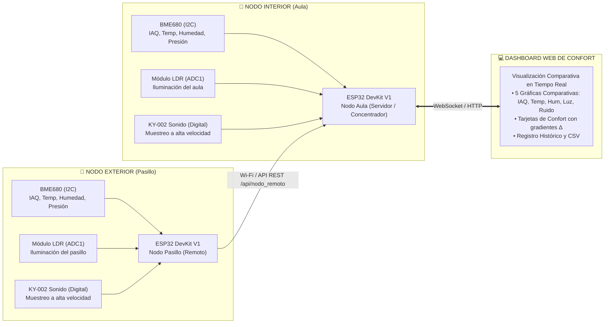

# UTN FRCU – Tecnologías para la Automatización ESP32 2026
## Confort IoT Multi-Nodo (Etapa 2) — Monitoreo Comparativo Aula vs. Pasillo

### Identificación del Proyecto (Etapa 2)
* **Número de equipo:** 9
* **Integrantes:**
  * Slootmans, Maria
  * Nuñez Baccón, Victoria
  * Valli, Franco Ignacio
* **Proyecto recibido de Etapa 1:** Aire IoT (Monitor mononodo interior con BME680, LEDs y buzzer).

### Descripción del Proyecto y Enfoque de Confort

En la **Etapa 2**, el proyecto cambia de enfoque: deja de ser un monitor centrado exclusivamente en el aire y la ventilación para convertirse en una **plataforma integral de análisis y monitoreo de confort ambiental y ergonómico**.

El sistema utiliza **dos módulos ESP32 interconectados** que comparan las condiciones ambientales entre dos recintos:
1. **Nodo Interior (Aula):** Mide el nivel de confort térmico, higrométrico, visual, acústico y calidad de aire dentro del aula.
2. **Nodo Exterior (Pasillo de la facultad):** Mide simultáneamente las mismas 5 variables de referencia en el pasillo adyacente.

Ambos nodos capturan 5 magnitudes de confort y sincronizan sus lecturas a través de la red local para presentarlas en un **dashboard web comparativo en tiempo real**.

### Componentes Descartados del Proyecto Original

* **LEDs de colores (verde, amarillo, rojo):** Se descartan. La señalización mediante LEDs discretos resulta innecesaria y queda superada por la visualización centralizada en el panel web.
* **Buzzer pasivo KY-006 (alarma sonora):** Se descarta. Las alarmas sonoras intermitentes resultan disruptivas en un aula universitaria; la supervisión se realiza visualmente mediante las métricas del dashboard.
* **Matriz de Decisión de Ventilación:** Se descartó la lógica de recomendación de apertura de puertas/ventanas para enfocar el sistema exclusivamente en la **comparación analítica y visual de las 5 variables de confort**.

### Las 5 Variables de Confort Analizadas

El panel web unificado grafica y compara simultáneamente en tiempo real:

1. **Calidad de Aire (IAQ):** Salubridad del aire respirable (0–500) según Bosch BSEC2.
2. **Confort Térmico (Temperatura en °C):** Sensación térmica y gradiente de temperatura entre el aula y el pasillo.
3. **Confort Higrométrico (Humedad Relativa en %):** Nivel de humedad óptimo para estudio y permanencia (35–60 % HR).
4. **Confort Lumínico / Visual (LDR en %):** Nivel de iluminación adecuada para lectura y uso de pantallas vs. luz natural del pasillo.
5. **Confort Acústico (Ruido Digital KY-002 en %):** Nivel de silencio y bullicio en el aula frente al ruido y circulación de personas en el pasillo.

### Desafío de Ingeniería: Muestreo del Sensor Digital de Sonido (KY-002)

El sensor KY-002 opera como un **dispositivo digital de conmutación / vibración** basado en comparador, no como un micrófono analógico de tensión continua. Ante perturbaciones acústicas o vibratorias que superan el umbral del potenciómetro, conmuta rápidamente a nivel activo mediante pulsos de microsegundos a milisegundos.

Si se realizara una lectura convencional cada 3 segundos, se perdería más del 99 % de los eventos acústicos. Por ello, el firmware implementa:
* **Muestreo a alta velocidad por interrupción de hardware:** Un conteo continuo a frecuencia de kHz (`attachInterrupt` por flanco `CHANGE`) acumulado en ventanas temporales de integración de 1 segundo.
* **Métricas calculadas:**
  * **Densidad de pulsos (Hz):** Frecuencia de transiciones por segundo.
  * **Índice de actividad sonora (0–100 %):** Proporción de actividad normalizada y filtrada digitalmente, permitiendo una comparación directa de confort acústico entre el aula y el pasillo.

### Componentes Utilizados (Hardware para los 2 Nodos)

| Componente | Cantidad | Función en el sistema |
| :--- | :---: | :--- |
| **ESP32 DevKit V1** | 2 | Microcontroladores principales (Nodo Aula y Nodo Pasillo). |
| **Bosch BME680 (I2C)** | 2 | Calidad de aire, Temperatura, Humedad y Presión barométrica. |
| **Módulos Fotorresistores LDR** | 2 | Medición analógica de iluminación ambiente conectada a **ADC1**. |
| **Sensores de sonido KY-002** | 2 | Detección digital de actividad sonora con muestreo a alta velocidad. |
| **Protoboards y jumpers** | 2 sets | Montaje físico independiente de cada nodo. |
| **Cables de alimentación USB** | 2 | Alimentación de 5 V para ambos microcontroladores. |

### Asignación de Pines y Cableado (Idéntico en Ambos Nodos)

> **Regla de diseño ADC en ESP32:** El conversor ADC2 queda bloqueado cuando el Wi-Fi transmite. Por esta razón, el sensor analógico LDR se conecta obligatoriamente a un canal de **ADC1** (GPIO 34).

| Señal | Pin ESP32 | Tipo | Función |
| :--- | :--- | :--- | :--- |
| **BME680 VCC / GND** | **3V3 / GND** | Alimentación | 3.3 V regulado (nunca 5 V) |
| **BME680 SDA / SCL** | **GPIO 21 / GPIO 22** | Digital I2C | Bus I2C de hardware |
| **BME680 SDO** | **GND** | Configuración | Fija dirección I2C en `0x76` |
| **BME680 CS** | **3V3** | Configuración | Fija el sensor en modo I2C |
| **LDR (Salida analógica)** | **GPIO 34** | Entrada Analógica | Conectado a **ADC1_CH6** (compatible con Wi-Fi) |
| **KY-002 (Salida digital S)** | **GPIO 25** | Entrada Digital | Pin con interrupción de hardware (muestreo a kHz) |

### Comunicación e Integración entre los Dos ESP32

Ambos módulos ejecutan el mismo firmware seleccionando su rol en tiempo de compilación o configuración (`ROL_AULA` o `ROL_PASILLO`):

* **Red Wi-Fi común:** Ambos nodos se asocian a la red Wi-Fi local o institucional configurada en `secrets.h`.
* **Modo Respaldo Autónomo (AP):** Si no hay Wi-Fi externo, el Nodo Aula crea el punto de acceso `AireIoT_Aula` (clave: `aire1234`), al cual el Nodo Pasillo se conecta automáticamente como estación.
* **Transmisión de telemetría:** El Nodo Pasillo transmite periódicamente un paquete JSON con sus 5 variables hacia el Nodo Aula mediante el endpoint `/api/nodo_remoto`.
* **Servidor Centralizado:** El Nodo Aula agrega los datos de ambos nodos, administra el historial combinado y sirve el dashboard web interactivo vía WebSocket y REST.

### Conceptos Teóricos Aplicados

1. **Monitoreo Diferencial de Confort:**
   El análisis comparativo simultáneo permite entender el comportamiento relativo del recinto frente a su entorno adyacente (gradiente térmico $\Delta T$, higrométrico $\Delta H$, acústico $\Delta \text{Ruido}$, lumínico $\Delta L$ y salubridad $\Delta IAQ$).

2. **Teoría de Muestreo de Señales Discretas (Nyquist / Ventana Estadística):**
   Al tratar con pulsos acústicos transitorios de corta duración en el sensor digital KY-002, se aplica un muestreo a alta frecuencia (kHz) e integración temporal para derivar una magnitud de estado continua (nivel de ruido %).

3. **Fusión Sensorial Multivariable:**
   La integración coordinada de luz (LDR), sonido (KY-002) y calidad de aire (BME680) permite modelar la ocupación del aula y caracterizar el confort ambiental de forma integral.

### Guía de Puesta en Marcha

1. **Configurar el firmware para cada nodo:**
   * En `firmware/aire_iot/config.h`:
     * Para la placa del aula: `#define NODO_ROL ROL_AULA`
     * Para la placa del pasillo: `#define NODO_ROL ROL_PASILLO`
2. **Cargar el programa:** Flashear ambos ESP32 con el entorno Arduino IDE (core 3.3.12).
3. **Acceder al Dashboard:** Conectar una PC o teléfono a la red y navegar a `http://aire.local` (o la IP asignada al Nodo Aula) para observar las 5 gráficas comparativas de confort en vivo.
